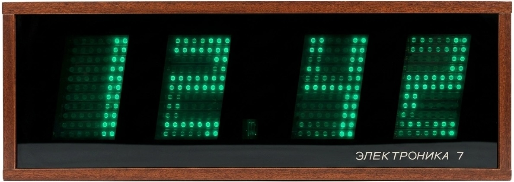

# "Elektronika 7-06K" clock emulation

A replica of an old Soviet clock based on the Arduino Nano.

Used components:

- Arduino Nano
- RTC DS3231 (emulated by [DS1307](https://docs.wokwi.com/parts/wokwi-ds1307) in Wokwi)
- Hand-crafted Led Matrix based on MAX7219 (emulated by [4-segment dot-maxtrix](https://docs.wokwi.com/parts/wokwi-max7219-matrix))
- Buttons
- Photoresistor (emulated by [LDR sensor module](https://docs.wokwi.com/parts/wokwi-photoresistor-sensor))

Online version at https://wokwi.com/projects/435810683682989057

## Simulate the project

To simulate this project, install [Wokwi for VS Code](https://marketplace.visualstudio.com/items?itemName=wokwi.wokwi-vscode). Open the project directory in Visual Studio Code, press **F1** and select "Wokwi: Start Simulator".
